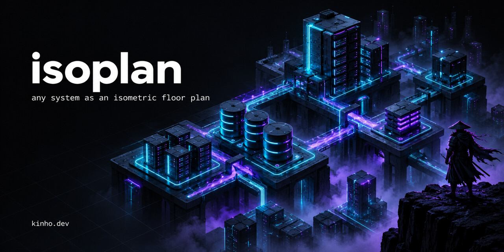
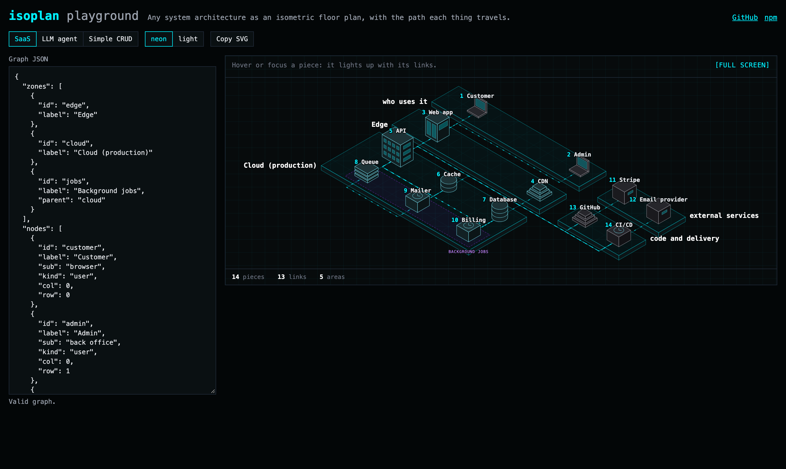

# isoplan



Render any system architecture as an isometric floor plan, with animated flows along every link.

**Try it:** [isoplan.kinho.dev](https://isoplan.kinho.dev), paste your graph and copy the SVG.

If isoplan is useful to you, [give it a ⭐](https://github.com/kayossouza/isoplan): it helps other people find it.



You describe zones, nodes and edges as plain data. isoplan lays them out as stacked slabs, puts an isometric building on each node by its kind, routes right-angle floor tracks between pieces and animates the path each thing travels. Hover or focus a piece and it lights up with its tracks, its flows and the pieces it talks to.

It ships as a React component and as a framework-free core that returns an SVG string, so you can also render it on the server or outside React.

## Install

```sh
npm install isoplan
```

React 18 or later is a peer dependency. isoplan has no runtime dependencies.

## Quick start

```tsx
import { IsoPlan, type Graph } from 'isoplan';
import 'isoplan/styles.css';

const graph: Graph = {
    zones: [{ id: 'cloud', label: 'Cloud' }],
    nodes: [
        { id: 'user', label: 'User', kind: 'user' },
        { id: 'web', label: 'Web app', kind: 'web', zone: 'cloud' },
        { id: 'api', label: 'API', kind: 'api', zone: 'cloud' },
        { id: 'db', label: 'Database', kind: 'db', zone: 'cloud' },
    ],
    edges: [
        { from: 'user', to: 'web', label: 'HTTPS' },
        { from: 'web', to: 'api', label: 'JSON' },
        { from: 'api', to: 'db', label: 'SQL', both: true },
    ],
};

export function Architecture() {
    return <IsoPlan graph={graph} title="Our architecture" />;
}
```

The playground in `demo/` has three larger examples (a SaaS, an LLM agent system and a simple CRUD) and a JSON editor. It runs at [isoplan.kinho.dev](https://isoplan.kinho.dev); locally, `npm run dev:demo`.

## Graph schema

```ts
interface Graph {
    zones?: { id: string; label: string; parent?: string | null }[];
    nodes: { id: string; label: string; sub?: string; kind: string; zone?: string | null; col?: number; row?: number }[];
    edges: { from: string; to: string; label?: string; both?: boolean }[];
}
```

| Field | Required | Meaning |
| --- | --- | --- |
| `zones[].id` | yes | Unique zone id. Ids starting with `_` are reserved. |
| `zones[].label` | yes | Name drawn next to the slab, or under the block for inner zones. |
| `zones[].parent` | no | Parent zone id. A top-level zone is a slab; a zone with a parent is a dashed block on its top-level slab. |
| `nodes[].id` | yes | Unique node id. |
| `nodes[].label` | yes | Name drawn above the piece. |
| `nodes[].sub` | no | Secondary line, shown in the info bar. |
| `nodes[].kind` | yes | Building shape, see the table below. |
| `nodes[].zone` | no | Zone id. Nodes without a zone go to an implicit area by kind. |
| `nodes[].col` | no | Column. Inside a slab, nodes with the same column share a sub-row, and slabs are ordered by the mean column of their nodes. Default `0`. |
| `nodes[].row` | no | Order inside the sub-row. Default: the node's position in `nodes`. |
| `edges[].from`, `edges[].to` | yes | Node ids. The flow runs from `from` to `to`. |
| `edges[].label` | no | Shown in the info bar. |
| `edges[].both` | no | Traffic goes both ways: the flow is animated in both directions. |

With no `col` or `row` at all, each slab gets one sub-row and its pieces follow the order of `nodes`.

Nodes without a zone are grouped by kind: `user` nodes go to a slab named "who uses it", `external` nodes to a side column named "external services", `repo` and `ci` nodes to a side column named "code and delivery", and every other kind to an unnamed slab. Rename the implicit areas with `labels`:

```tsx
<IsoPlan graph={graph} title="Arquitetura" labels={{ user: 'quem usa', external: 'serviços externos', repo: 'código e entrega' }} />
```

`renderPlan` and `<IsoPlan>` validate the graph and throw an `Error` with a clear message on duplicate ids, edges to unknown nodes, unknown zones or parents, parent cycles and an empty `nodes` list. Call `validateGraph(graph)` to check user input before rendering.

## Node kinds

| Kind | Shape |
| --- | --- |
| `api` | Office building with windows |
| `agent` | Office building with an antenna |
| `web` | Tall block with two front windows |
| `user` | Laptop |
| `db` | Cylinder with two rings |
| `cache` | Short cylinder with one ring |
| `queue` | Stack of three plates |
| `storage` | Stepped pyramid |
| `repo` | Stepped pyramid, gray |
| `function` | Low block with a clock |
| `worker` | Low block with a clock |
| `ci` | Low block with a clock, gray |
| `container` | Two stacked offset blocks |
| `external` | Block with a side window, gray |
| `identity`, any other string | Block with a side window |

`user`, `external`, `repo` and `ci` pieces are drawn in gray, so third parties stand apart from your own system.

## Flows

Every edge gets an animated flow: dashes that travel along its track from `from` to `to`. Edges with `both: true` get a second flow in the opposite direction. On hover or focus, the flows of the active piece brighten and the others dim.

```tsx
<IsoPlan graph={graph} title="..." flows={false} />   // tracks only
<IsoPlan graph={graph} title="..." flowSpeed={24} />  // slower; SVG units per second, default 48
```

The animation is pure CSS. With `prefers-reduced-motion: reduce` the dashes stay still.

## Component props

| Prop | Default | Meaning |
| --- | --- | --- |
| `graph` | required | The graph to draw. |
| `title` | required | Accessible name of the drawing. |
| `theme` | `'neon'` | `'neon'` or `'light'`. |
| `flows` | `true` | Animated flows along the tracks. |
| `flowSpeed` | `48` | Flow speed in SVG units per second. |
| `labels` | English | Names of the implicit areas: `{ user, external, repo }`. |
| `copy` | English | On-screen text: `{ hint, out, in, number, pieces, links, areas, expand, close }`. Pass any subset. |
| `expandable` | `true` | Shows the full screen toggle. Escape closes full screen. |
| `onSelect` | none | Called with the piece when it is clicked or activated with Enter or Space. |
| `className` | none | Extra class on the root element. |

Example of a Portuguese copy:

```tsx
<IsoPlan
    graph={graph}
    title="Arquitetura"
    copy={{ hint: 'Passe o mouse ou foque uma peça.', out: 'saem para', in: 'entram de', number: 'nº ', pieces: 'peças', links: 'ligações', areas: 'áreas', expand: 'tela cheia', close: 'fechar' }}
/>
```

## Theming

`isoplan/styles.css` defines every color as a CSS custom property on `.isoplan`. The `neon` theme is a near-black blueprint with cyan pieces and purple inner zones; `light` is a pale blueprint. Override any variable in a rule loaded after `isoplan/styles.css`:

```css
.isoplan {
    --iso-accent: #ff6b00;
    --iso-flow: #ff6b00;
    --iso-zone: #22c55e;
}
```

| Variable | Used for |
| --- | --- |
| `--iso-bg`, `--iso-bg-grid` | Background and its grid |
| `--iso-border`, `--iso-text`, `--iso-text-strong`, `--iso-muted`, `--iso-dim`, `--iso-accent` | Frame, info bar and stats |
| `--iso-stroke`, `--iso-top`, `--iso-left`, `--iso-right`, `--iso-window` | Pieces |
| `--iso-ext-stroke`, `--iso-ext-top`, `--iso-ext-left`, `--iso-ext-right` | Gray pieces |
| `--iso-slab`, `--iso-slab-top`, `--iso-slab-stroke`, `--iso-grid` | Slabs |
| `--iso-zone`, `--iso-zone-fill`, `--iso-zone-text`, `--iso-area-text` | Inner zones and area names |
| `--iso-track`, `--iso-flow` | Tracks and flows |
| `--iso-label`, `--iso-num`, `--iso-halo`, `--iso-label-on` | Piece labels |
| `--iso-on-top`, `--iso-on-left`, `--iso-on-right`, `--iso-linked-top` | Highlighted pieces |
| `--iso-font`, `--iso-min-width` | Font and the drawing's minimum width (it scrolls sideways below it) |

## Without React, and SSR

The core lives in `isoplan/core`. It has no React import and no DOM access, so it runs in Node, in edge runtimes and in React Server Components.

```ts
import { renderPlan } from 'isoplan/core';

const plan = renderPlan(graph, { flows: true, labels: { user: 'customers' } });
// plan.svg: inner SVG markup; plan.viewBox; plan.pieces; plan.links; plan.areas
const html = `<div class="isoplan" data-theme="neon"><div class="iso-scene"><svg viewBox="${plan.viewBox}">${plan.svg}</svg></div></div>`;
```

The `isoplan` entry starts with `"use client"`, so in the Next.js App Router you can render `<IsoPlan>` from a server component as a client component. Import from `isoplan/core` when you only need `renderPlan` on the server.

All text in the graph (labels, ids, zone names, area names) is escaped before it goes into the SVG.

## Accessibility

- The SVG has `role="img"`, an `aria-label` and a `<title>` from the `title` prop.
- Every piece is focusable (`tabindex="0"`), has `role="button"` and an `aria-label` with its number and label.
- Focusing a piece highlights it like hover does, and the info bar (`aria-live="polite"`) announces the piece and its links.
- Enter and Space activate the focused piece (`onSelect`).
- The full screen toggle is a real button with `aria-pressed`; Escape closes full screen.
- Animations stop under `prefers-reduced-motion: reduce`.

## Development

```sh
npm install
npm run typecheck
npm test
npm run build          # dist/: ESM, CJS, .d.ts and styles.css
npm run dev:demo       # playground on localhost
npm run build:demo     # static playground in demo/dist
```

`npm run build:demo` writes static files to `demo/dist`. Set `DEMO_BASE` to serve it from a sub-path, for example `DEMO_BASE=/isoplan/ npm run build:demo`. `vercel.json` points Vercel at that build.

## Credits

Extracted from [kinho.dev](https://kinho.dev) by Kayo Souza, where it renders the high-level designs of the case studies.

## License

[MIT](LICENSE)
